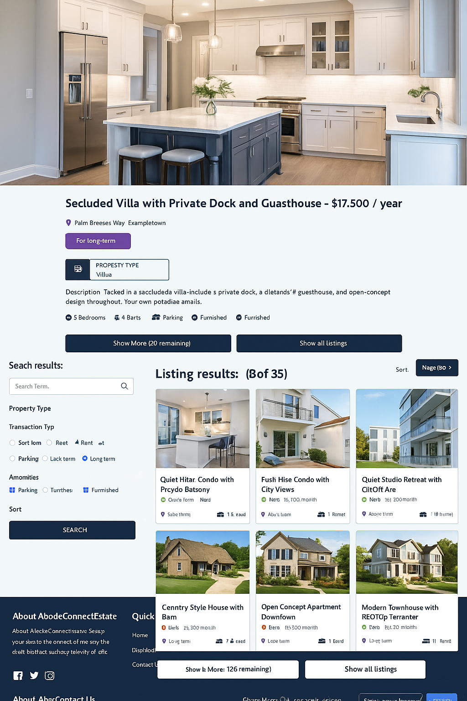

@'
# 🏠 EstateHub — Real Estate Marketplace

A full-stack real estate marketplace built with the **MERN stack**, featuring secure authentication, property listing management, advanced search, image uploads, and a responsive React interface.



---

## 🚀 Overview

**EstateHub** is a modern real estate marketplace that connects users with property listings through a responsive web application.

The project demonstrates full-stack development using **React, Node.js, Express, and MongoDB**, with JWT-based authentication, Redux state management, Firebase integration, and Cloudinary image hosting.

### Key Highlights

- 🔐 JWT-based authentication
- 🏡 Create, update, and delete property listings
- 🔎 Property search and filtering
- 🖼️ Cloudinary image uploads
- 👤 User profile management
- ❤️ Save/favorite property listings
- 📱 Responsive React UI
- ⚡ Vite-powered frontend
- 🗃️ MongoDB with Mongoose
- 🔄 Redux Toolkit state management
- 🛡️ Protected API routes
- 📚 Swagger API documentation

---

## 🏗️ Architecture

```mermaid
flowchart TD
    U[User] --> C[React Frontend]
    C --> R[React Router]
    C --> RTK[Redux Toolkit]
    C --> API[REST API]

    API --> E[Express.js]
    E --> AUTH[JWT Authentication]
    E --> CTRL[Controllers]
    CTRL --> M[Mongoose]
    M --> DB[(MongoDB)]

    CTRL --> CL[Cloudinary]
    C --> FB[Firebase]

    DB --> DATA[Users & Property Listings]
    CL --> IMG[Property Images]